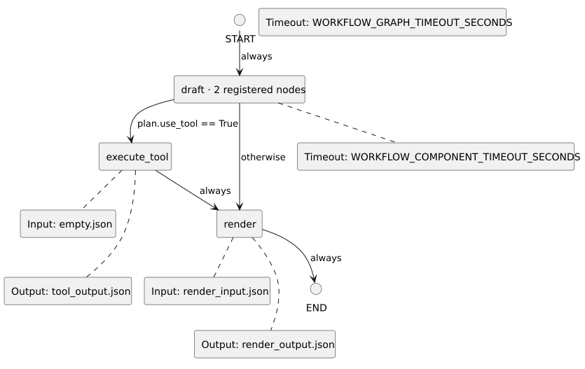

<!-- api-agent-companion-v1 sha256:0b89c9041bbe2bd9e05a77f3d01404db6a03f15fd2ab7ec6c8edc601993c05d2 -->
# Workflow diagram: useful_api_demo

[Open standalone diagram](flow.svg)

[Source declaration](../../../../demo/simple/flow.md.html)

## Navigation

- [draft](workflows/components/draft.md)
- [execute_tool](workflows/components/execute_tool.md)
- [render](workflows/components/render.md)
