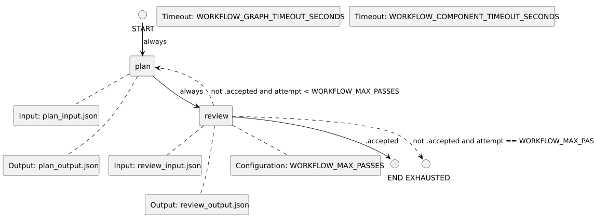

<!-- api-agent-companion-v1 sha256:5c5685cdd01ad8507c4cc602ed056807c970bbd9239f181eda1cf30b0269aaf3 -->
# Workflow diagram: draft

[Open standalone diagram](draft.svg)

[Source declaration](../../../../../../demo/simple/workflows/components/draft.md.html)

## Navigation

- [useful_api_demo](../../flow.md)
- [execute_tool](execute_tool.md)
- [render](render.md)
