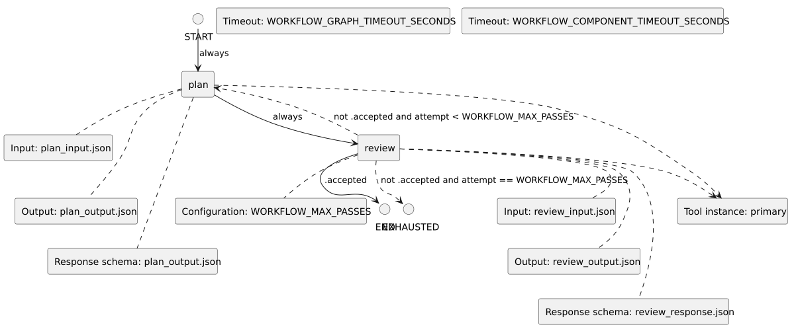

<!-- api-agent-companion-v1 sha256:d00215c3bd46c916ab096ee2de92fdef06e417e9ad19682c51c19f13d62af67c -->
# Workflow diagram: draft

[Open standalone diagram](draft.svg)

[Source declaration](../../../../../../demo/simple/workflows/components/draft.md.html)
