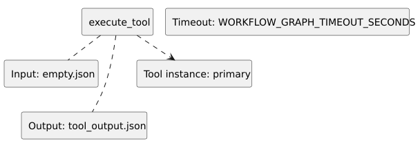

<!-- api-agent-companion-v1 sha256:8830d1d5f9d209ceef9a61d4c423fb78f9440d835f3475f7c4845bec5bb89c4c -->
# Workflow diagram: execute_tool

[Open standalone diagram](execute_tool.svg)

[Source declaration](../../../../../../demo/simple/workflows/components/execute_tool.md.html)

## Navigation

- [useful_api_demo](../../flow.md)
- [draft](draft.md)
- [render](render.md)
