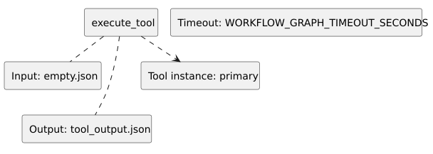

<!-- api-agent-companion-v1 sha256:52d61d81e2772ceb908c0426a98e50032572e315016a0e09142ec9d3e951ad3b -->
# Workflow diagram: execute_tool

[Open standalone diagram](execute_tool.svg)

[Source declaration](../../../../../../demo/simple/workflows/components/execute_tool.md.html)
