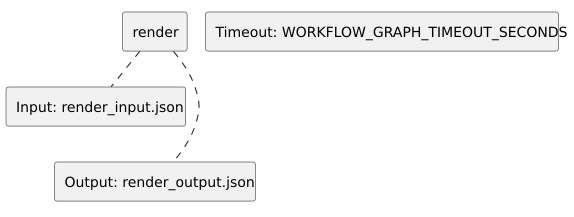

<!-- api-agent-companion-v1 sha256:56c89d28f431312cebd03721b73ec6b7866f4a5a1fdba16fc4310dee110edf71 -->
# Workflow diagram: render

[Open standalone diagram](render.svg)

[Source declaration](../../../../../../demo/simple/workflows/components/render.md.html)

## Navigation

- [useful_api_demo](../../flow.md)
- [draft](draft.md)
- [execute_tool](execute_tool.md)
