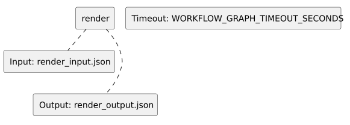

<!-- api-agent-companion-v1 sha256:7d4fc090700993f1756963f71b7045f36bbc928d403bf51e5696f504f79dd293 -->
# Workflow diagram: render

[Open standalone diagram](render.svg)

[Source declaration](../../../../../../demo/simple/workflows/components/render.md.html)
