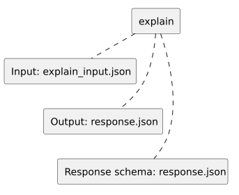

<!-- api-agent-companion-v1 sha256:459077b8d83dfda34632553d5cc41e7877f6c82b83859d0c54451066db922d2a -->
# Workflow diagram: explain

[Open standalone diagram](explain.svg)

[Source declaration](../../../../../../tests/e2e/fixtures/node_summary/explain.md.html)

## Navigation

- [optional_node_summary](flow.md)
- [finish](finish.md)
