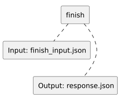

<!-- api-agent-companion-v1 sha256:500713587ee589c9a681c9f7c151830df4a525b5b574fb35ce77fe300bac6df7 -->
# Workflow diagram: finish

[Open standalone diagram](finish.svg)

[Source declaration](../../../../../../tests/e2e/fixtures/node_summary/finish.md.html)

## Navigation

- [optional_node_summary](flow.md)
- [explain](explain.md)
