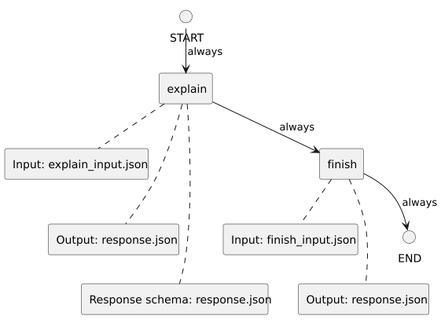

<!-- api-agent-companion-v1 sha256:05d774105f5c2af886d247cbf7d5448b1dc35168b703e79bcbe987c517a09184 -->
# Workflow diagram: optional_node_summary

[Open standalone diagram](flow.svg)

[Source declaration](../../../../../../tests/e2e/fixtures/node_summary/flow.md.html)

## Navigation

- [explain](explain.md)
- [finish](finish.md)
