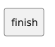

<!-- api-agent-companion-v1 sha256:7a0be94aac5b10deada8a340c77b683af4e07db28ba4a3f13a848fc9ad1d5725 -->
# Workflow diagram: finish

[Open standalone diagram](finish.svg)

[Source declaration](../../../../../tests/fixtures/artifact_qualification/finish.md.html)

## Navigation

- [artifact_qualification](flow.md)
- [intake](intake.md)
- [review](review.md)
- [work](work.md)
