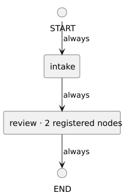

<!-- api-agent-companion-v1 sha256:e6a621e76bcd5f2b3004bda51dda422d270217b2ef9bf4b42bbc692771aa07b5 -->
# Workflow diagram: artifact_qualification

[Open standalone diagram](flow.svg)

[Source declaration](../../../../../tests/fixtures/artifact_qualification/flow.md.html)

## Navigation

- [intake](intake.md)
- [review](review.md)
- [work](work.md)
- [finish](finish.md)
