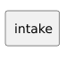

<!-- api-agent-companion-v1 sha256:9ea7f835103ab28f18a91ea14db5101ece3459c4b9695068653741c554318524 -->
# Workflow diagram: intake

[Open standalone diagram](intake.svg)

[Source declaration](../../../../../tests/fixtures/artifact_qualification/intake.md.html)

## Navigation

- [artifact_qualification](flow.md)
- [review](review.md)
- [work](work.md)
- [finish](finish.md)
