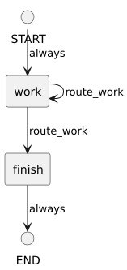

<!-- api-agent-companion-v1 sha256:c4ab6bf3bc8673bebdfb7a518342c61937e02d0452b1a1fa18e602682462c173 -->
# Workflow diagram: review

[Open standalone diagram](review.svg)

[Source declaration](../../../../../tests/fixtures/artifact_qualification/review.md.html)

## Navigation

- [artifact_qualification](flow.md)
- [intake](intake.md)
- [work](work.md)
- [finish](finish.md)
