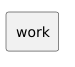

<!-- api-agent-companion-v1 sha256:b5b91c7bf67793d4661f0b8cf4928a4ddbd14bbdd5bd233e3b556f06e5aab8d0 -->
# Workflow diagram: work

[Open standalone diagram](work.svg)

[Source declaration](../../../../../tests/fixtures/artifact_qualification/work.md.html)

## Navigation

- [artifact_qualification](flow.md)
- [intake](intake.md)
- [review](review.md)
- [finish](finish.md)
