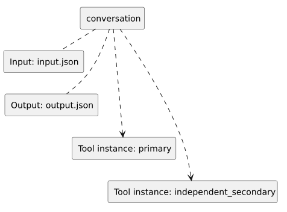

<!-- api-agent-companion-v1 sha256:34c23c683b6acb0c6496885edc1735b9a4465b74cde7fdf954b6559301a9c9c2 -->
# Workflow diagram: conversation

[Open standalone diagram](conversation.svg)

[Source declaration](../../../../../../../tests/integration/fixtures/tool_instances/independent/conversation.md.html)
