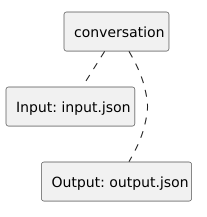

<!-- api-agent-companion-v1 sha256:8b231e628b4d8b5f1c5e11c827771b5918e53fc0a7bfe7109954a45adbb0834e -->
# Workflow diagram: conversation

[Open standalone diagram](conversation.svg)

[Source declaration](../../../../../../../tests/integration/fixtures/tool_instances/independent/conversation.md.html)

## Navigation

- [independent_tools](flow.md)
