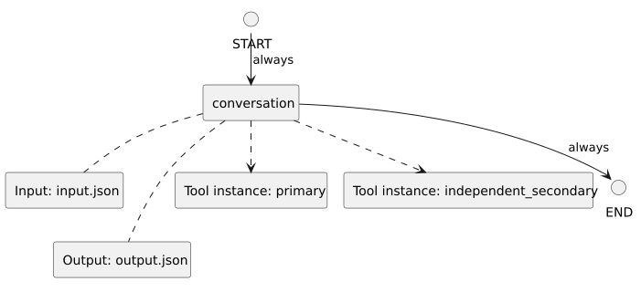

<!-- api-agent-companion-v1 sha256:99a2c66786111a7e063ab26070caa1f9ecd2c260dfd7ff7d105cfa4f978d0f7b -->
# Workflow diagram: independent_tools

[Open standalone diagram](flow.svg)

[Source declaration](../../../../../../../tests/integration/fixtures/tool_instances/independent/flow.md.html)

## Navigation

- [conversation](conversation.md)
