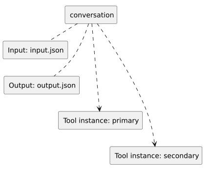

<!-- api-agent-companion-v1 sha256:d386371d15e925c55a7a6b70147713d795e1c786126729526a075dcea821ad32 -->
# Workflow diagram: conversation

[Open standalone diagram](conversation.svg)

[Source declaration](../../../../../../../tests/integration/fixtures/tool_instances/shared_primary/conversation.md.html)
