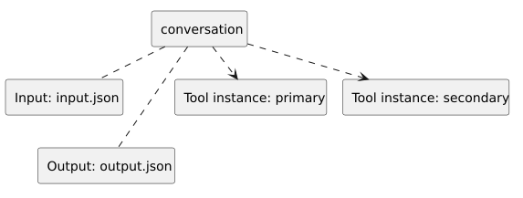

<!-- api-agent-companion-v1 sha256:c1beba22a47cbe8d4895248030805f92ebbfd6d364c7a5a7435448a6d95bd7e4 -->
# Workflow diagram: conversation

[Open standalone diagram](conversation.svg)

[Source declaration](../../../../../../../tests/integration/fixtures/tool_instances/shared_primary/conversation.md.html)

## Navigation

- [shared_primary_tools](flow.md)
