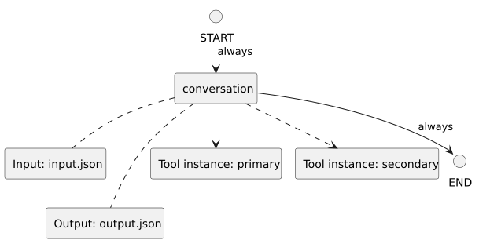

<!-- api-agent-companion-v1 sha256:597576821822cdd84b7719a475ee6e576da727602f95208f263b1a7a2aabfecb -->
# Workflow diagram: shared_primary_tools

[Open standalone diagram](flow.svg)

[Source declaration](../../../../../../../tests/integration/fixtures/tool_instances/shared_primary/flow.md.html)

## Navigation

- [conversation](conversation.md)
