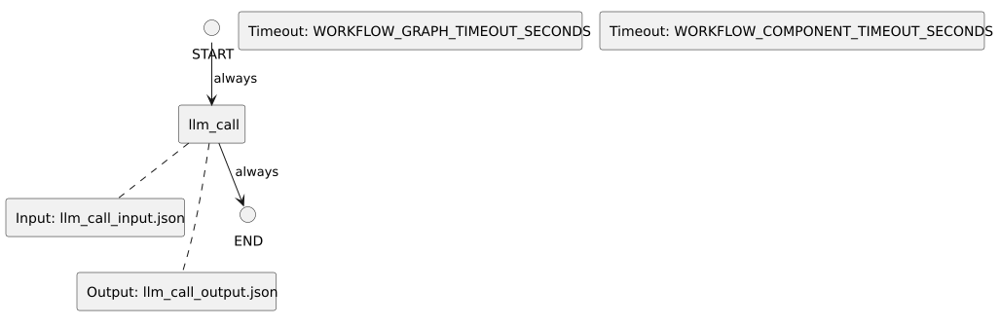

<!-- api-agent-companion-v1 sha256:037c531e40a924459b9f5a8b9960fed36695f9e77d814f0b249dd5fc583e53b3 -->
# Workflow diagram: agent

[Open standalone diagram](agent.svg)

[Source declaration](../../../../workflows/components/agent.md.html)

## Navigation

- [simple_chat](../../flow.md)
- [llm_call](agent/llm_call.md)
