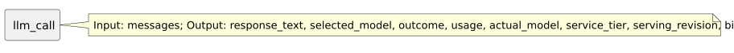

<!-- api-agent-companion-v1 sha256:1313811717efcdfc5db0226372e903e69e024d6a69ab3dc7deb3e6861e8f93a8 -->
# Workflow diagram: llm_call

[Open standalone diagram](llm_call.svg)

[Source declaration](../../../../../workflows/components/agent/llm_call.md.html)

## Navigation

- [simple_chat](../../../flow.md)
- [agent](../agent.md)
