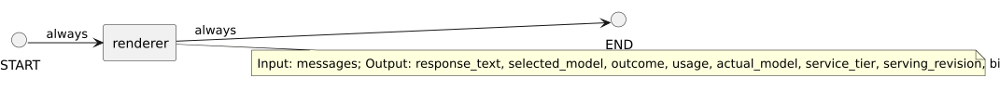

<!-- api-agent-companion-v1 sha256:a6d710a90bee6e82d8bf31981d992f47169c846029a7351cd170f4baddcac062 -->
# Workflow diagram: renderer

[Open standalone diagram](renderer.svg)

[Source declaration](../../../../workflows/components/renderer.md.html)

## Navigation

- [simple_chat](../../flow.md)
