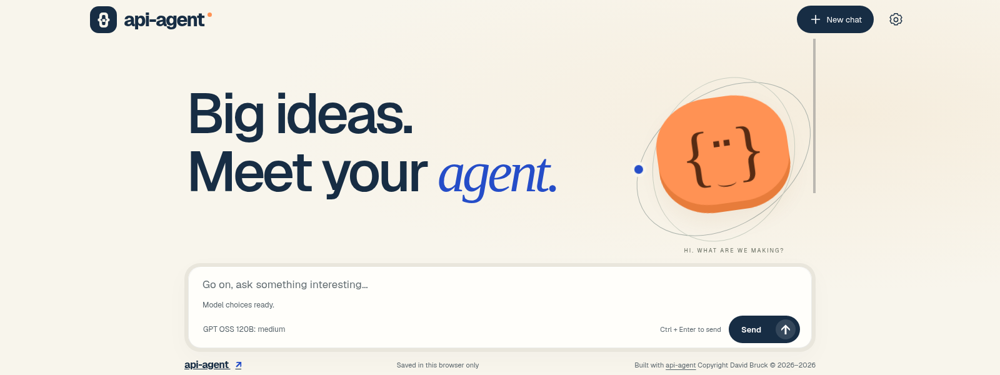
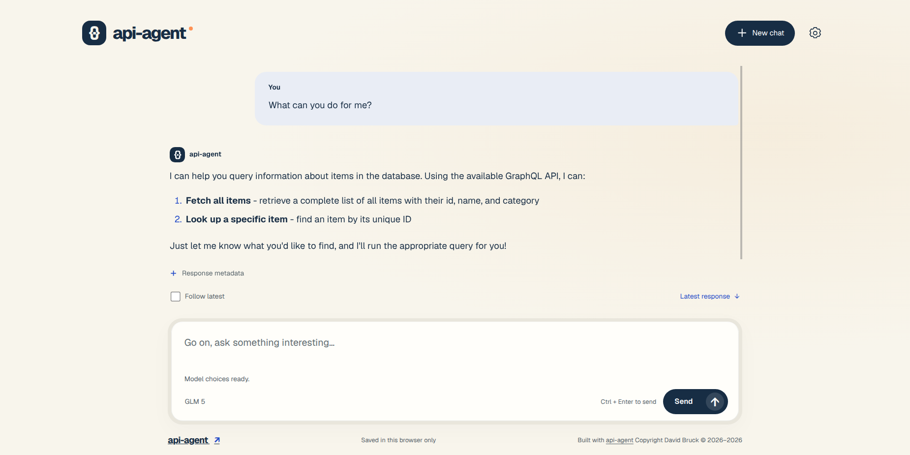
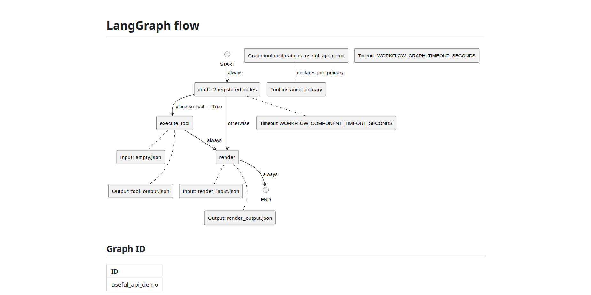

# api-agent

api-agent is a local workbench for building, running and testing API-connected agents.

Define workflows in readable Markdown, inspect their diagrams, and try them in
the included Studio chat UI. Use the guided terminal launcher to configure
connections, start local services, run tests and inspect failures.

## Included

- **Replaceable LLM connections:** OpenAI subscription or API-key access,
  compatible endpoints such as OpenRouter, and Bedrock Mantle with session,
  access-key or API-key authentication. Select an included provider or add your own.
  Contributions welcome to add Anthropic / Claude support as another
  out-of-the-box option.

- **Executable workflows:** a small default chat graph plus a separate
  [API demonstration](docs/api_demo.md) combining LLM and deterministic nodes,
  a GraphQL MCP tool and a synthetic backend. Extend the declared tools and
  native adapters for other APIs and protocols.

- **Studio chat UI:** run `./launch.sh --tui-mode run-local --run-ui`, or save
  `RUN_UI=True` and choose Run local. Use or adapt the UI while retaining David
  Bruck's copyright notice, the license conditions and disclaimer; binary
  redistributions must reproduce them in accompanying materials. See [LICENSE](LICENSE).

- **Selected prerequisites:** nested configuration, provider Python packages,
  tool-contributed mise runtimes and recursive local container dependencies.
  [Add a tool, including one in another language](docs/tool-executables.md).

- **Inspection and testing:** selectable tests, failure details, token/cost
  accounting, Allure reports, optional OpenTelemetry/GenAI or LangFuse tracing,
  and retained DEBUG browsers for human or coding-agent inspection.

- **Assisted authentication:** optional password-manager adapters for supported
  UI and LLM sign-in steps; some challenges still require human approval.

<picture>
  <source media="(prefers-color-scheme: dark)" srcset=".private_resources/demo/ui-studio-start-dark.png">
  
</picture>
<picture>
  <source media="(prefers-color-scheme: dark)" srcset=".private_resources/demo/ui-studio-prompt-dark.png">
  
</picture>
<picture>
  <source media="(prefers-color-scheme: dark)" srcset=".private_resources/demo/flow-md-dark.png">
  
</picture>

## Get started

On Unix-like systems with a POSIX shell,
[mise](https://mise.jdx.dev/installing-mise.html) is always required.
Docker is a development dependency required
[only for certain local services](docs/prerequisites.md#when-docker-is-needed),
tools and tests. Mise supplies this
project's Python, uv, Node.js and npm; you do not need to install those separately.
Install mise with one of these official commands:

```sh
curl https://mise.run | sh
```

Or, with wget:

```sh
wget -qO- https://mise.run | sh
```

If neither command is available, open `https://mise.run` in a browser, save the
raw installer script, open a terminal in its download directory, and run it with
`sh`. Follow mise's [shell setup instructions](https://mise.jdx.dev/shell-setup.html)
for your shell's startup file, such as `.bashrc` or `.zshrc`, so mise is available
in future terminals. The installer cannot change the terminal that started it.
For its default installation, make mise available in this terminal now:

```sh
export PATH="$HOME/.local/bin:$PATH"
command -v mise
mise --version
```

For a custom installation location, use that location instead. Download and
extract the repository ZIP, or use a Git checkout. Open a terminal in that
repository directory, then run:

```sh
chmod +x launch.sh # if the downloaded ZIP lost executable permissions
./launch.sh
```

The launcher prepares Python/uv and its existing base Python environment,
then opens the terminal menu. Choose **Run local** to start the app. Later
launches reuse installed tools. Existing command-line options follow
`./launch.sh` unchanged. Initial preparation needs internet access and writable
user storage; a Git checkout is not required. Node/npm and other optional tools
are acquired when an operation needs them.

In **Review configuration**, set `RUN_UI=True` to launch the connected UI too.
For packs offering a managed upstream API, set `API_ENDPOINT` to a remote URL,
or save an explicit blank to launch that API locally alongside the agent.
`AGENT_DJANGO_URL` is the agent's own address, not the upstream API setting.
See [setup and configuration](docs/workbench.md#getting-started).

Run local opens one headed browser when `RUN_UI=True` or `DEBUG=True`: agent
home first, an enabled ready tracing dashboard next, the [actual LangGraph flow](flow.md.html), and the optional prepared UI last.
With both settings false, it prints the home and flow URLs without opening a
browser or authenticating an LLM. To use the same operation without the TUI:

```bash
./launch.sh --tui-mode run-local --no-std-in
```

Press Ctrl+C to stop the terminal operation; use Stop or Quit in the TUI.
Shutdown waits for owned requests and resources to finish cleanup.
[Tracing configuration](docs/tracing.md) enables a ready Jaeger or LangFuse dashboard;
LangFuse dashboard login uses its separately configured admin account. To inspect a managed local collector without starting the app or a provider, run `./launch.sh --trace-viewer`; the command prints its viewer/CDP URLs and, for LangFuse, the configured dashboard username and password unmasked for login from another browser. Closing its browser leaves the collector available; press Ctrl+C in the terminal to release the collector lease.
UI-process logs show safe activity messages rather than
arbitrary child output, which may contain credentials even with `LOG_CONTENT=True`.

## Guides

- [Settings and TUI controls](docs/workbench.md)
- [Credentials and LLM connections](docs/connections.md)
- [Included Bedrock provider and conditional AWS setup](src/api_agent/llm_providers/bedrock/README.md)
- [Resource packs: tools, LLM/UI providers and configuration](docs/resource-packs.md)
- [Provider-owned integration test profiles](docs/integration_test_profiles.md)
- [Running, debugging and testing](docs/development.md)
- [Workflow diagrams and browser inspection](docs/workflow_viewer.md)
- [Bundled API demonstration](docs/api_demo.md)

**Developing with a coding agent?** Follow setup above and use an agent with
terminal access. For browser inspection, configure Chrome DevTools MCP (preferred)
or Playwright MCP. See [developer setup](docs/development.md#developer-environment-and-builds)
for prerequisites and connection instructions.

## Known issues

- **Managed local LangFuse has known development credentials:**
  `admin@local.dev` / `password`. Anyone who can reach that dashboard can try
  these defaults; keep it local and override them for other use. Existing
  accounts are not reset by changing initialization settings. The planned
  [safe multi-stage runtime image](docs/prds/implementation_plan_k2a.md#deployment-dashboard-credential-defaults)
  will clear both admin defaults to empty and require explicit configuration
  when LangFuse is selected; that image work remains pending.

  - **Workaround:** set `LANGFUSE_ADMIN_EMAIL` and `LANGFUSE_ADMIN_PASSWORD`
    in `.env` or the environment before initializing a new managed LangFuse
    instance. These settings do not change an existing account's credentials.

- **API-key mode needs a configured password-manager entry.** Manual key entry
  is [not implemented](docs/prds/implementation_plan_f2.md); the attended-login
  alternative applies to subscription authentication.

- Some authentication challenges remain manual; 1Password CLI must already be
  signed in. See [authentication limitations and workarounds](docs/authentication-limitations.md)
  for hardware keys, Keeper software passkeys, OAuth refresh and CLI recovery.

## Testing

Choose `unit`, `integration`, or `e2e` as `<tests_type>`:
```bash
./launch.sh --tui-mode "<tests_type>"
```

All tests start selected. Add positional selectors to preselect tests, or adjust
selection in the TUI. Append `--no-std-in` for terminal automation, or export
`NO_STD_IN=True` for multiple commands. Integration requires `--start=True` or `--debug`;
E2E requires `--start=E2E` as human acceptance. These tests may spend tokens.
With `DEBUG=True` and more than one distinct integration or E2E test selected,
execution asks for literal `y` before opening browsers, including with `--no-std-in`.
Set `DEBUG=False` and omit `--debug` to avoid the prompt.
See [test controls and automation](docs/development.md#testing).

For the full unit line/branch gate and provider/API/authentication matrix, see
[test qualification](docs/testing_qualification.md).

## Workflow design

The [workflow guide](docs/workflow_poc.md) covers Markdown declarations,
inference-free validation and mandatory route coverage, which needs no calibration
baseline. The [API demonstration](docs/api_demo.md) uses its own declared flow;
the root remains the small one-call chat example.

Open [flow.md.html](flow.md.html) directly to view the saved declaration and SVG,
or run `./launch.sh --view-flow` for the selected application's managed view.
Supply one path, such as `./launch.sh --view-flow "demo/contrived/flow.md.html"`,
to inspect another flow; relative paths use the current directory.
[Diagram maintenance](docs/workflow_viewer.md) explains markup freshness checks,
optional generation prerequisites and staged pre-commit checks.
