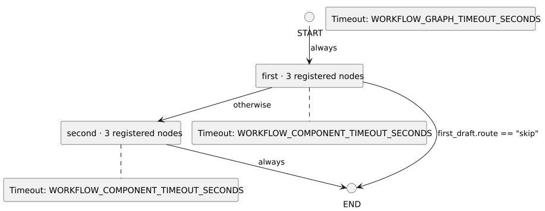

<!-- api-agent-companion-v1 sha256:3ee45a57419834c589290d71b8075d5dc24465d42d54bfce1c081b1ca035889d -->
# Workflow diagram: contrived_qualification

[Open standalone diagram](flow.svg)

[Source declaration](../../../contrived/flow.md.html)

## Navigation

- [first](workflows/components/first.md)
- [second](workflows/components/second.md)
