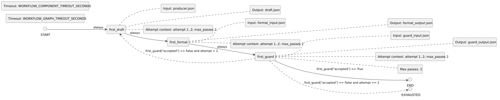

<!-- api-agent-companion-v1 sha256:b25b6104030f8138382e51b05d078dda26f7bc2d1c4c12edecc26175ed9b347b -->
# Workflow diagram: first

[Open standalone diagram](first.svg)

[Source declaration](../../../../../contrived/workflows/components/first.md.html)

## Navigation

- [contrived_qualification](../../flow.md)
- [second](second.md)
