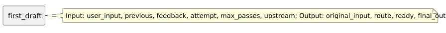

<!-- api-agent-companion-v1 sha256:c73014861a9cf1e704a9cf1619be8f7341afc3b08d27af8244cf337779ce131f -->
# Workflow diagram: first_draft

[Open standalone diagram](first_draft.svg)

[Source declaration](../../../../../../contrived/workflows/components/first/first_draft.md.html)

## Navigation

- [contrived_qualification](../../../flow.md)
- [first](../first.md)
- [first_format](first_format.md)
- [first_guard](first_guard.md)
- [second](../second.md)
- [second_draft](../second/second_draft.md)
- [second_format](../second/second_format.md)
- [second_guard](../second/second_guard.md)
