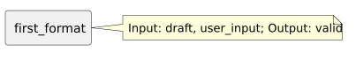

<!-- api-agent-companion-v1 sha256:c6b78e45aed497bb8d4bcff3fc27dc3decbe05d79aa3a7948f046655c88ae07f -->
# Workflow diagram: first_format

[Open standalone diagram](first_format.svg)

[Source declaration](../../../../../../contrived/workflows/components/first/first_format.md.html)

## Navigation

- [contrived_qualification](../../../flow.md)
- [first](../first.md)
- [first_draft](first_draft.md)
- [first_guard](first_guard.md)
- [second](../second.md)
- [second_draft](../second/second_draft.md)
- [second_format](../second/second_format.md)
- [second_guard](../second/second_guard.md)
