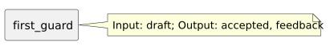

<!-- api-agent-companion-v1 sha256:009139c88f35874824531773b93745a9ae61d3823e9ebf518dfa17bb6435f3da -->
# Workflow diagram: first_guard

[Open standalone diagram](first_guard.svg)

[Source declaration](../../../../../../contrived/workflows/components/first/first_guard.md.html)

## Navigation

- [contrived_qualification](../../../flow.md)
- [first](../first.md)
- [first_draft](first_draft.md)
- [first_format](first_format.md)
- [second](../second.md)
- [second_draft](../second/second_draft.md)
- [second_format](../second/second_format.md)
- [second_guard](../second/second_guard.md)
