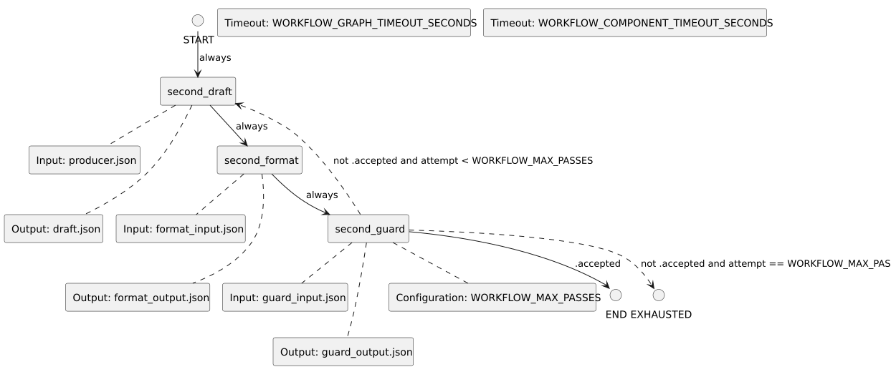

<!-- api-agent-companion-v1 sha256:15a7f729dacbd0f7c2929c6306b3fa2fd2bfda291388becf00bba778f811be7c -->
# Workflow diagram: second

[Open standalone diagram](second.svg)

[Source declaration](../../../../../contrived/workflows/components/second.md.html)

## Navigation

- [contrived_qualification](../../flow.md)
- [first](first.md)
