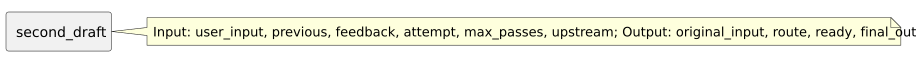

<!-- api-agent-companion-v1 sha256:c54b941232560eca97c9107c60c3ed69789d878e938a470f4f23465d90b6fd85 -->
# Workflow diagram: second_draft

[Open standalone diagram](second_draft.svg)

[Source declaration](../../../../../../contrived/workflows/components/second/second_draft.md.html)

## Navigation

- [contrived_qualification](../../../flow.md)
- [first](../first.md)
- [first_draft](../first/first_draft.md)
- [first_format](../first/first_format.md)
- [first_guard](../first/first_guard.md)
- [second](../second.md)
- [second_format](second_format.md)
- [second_guard](second_guard.md)
