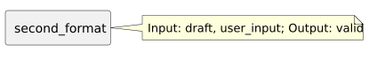

<!-- api-agent-companion-v1 sha256:6978caf46f45427fe73fe8435830eaf9ec878e061065b9c3f976fa83a86c8bc3 -->
# Workflow diagram: second_format

[Open standalone diagram](second_format.svg)

[Source declaration](../../../../../../contrived/workflows/components/second/second_format.md.html)

## Navigation

- [contrived_qualification](../../../flow.md)
- [first](../first.md)
- [first_draft](../first/first_draft.md)
- [first_format](../first/first_format.md)
- [first_guard](../first/first_guard.md)
- [second](../second.md)
- [second_draft](second_draft.md)
- [second_guard](second_guard.md)
