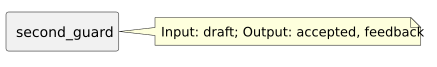

<!-- api-agent-companion-v1 sha256:66d9b81a7db9b01c94538bae5adec30c1cd5d3f4243cf1d51de81ad5b338a7f5 -->
# Workflow diagram: second_guard

[Open standalone diagram](second_guard.svg)

[Source declaration](../../../../../../contrived/workflows/components/second/second_guard.md.html)

## Navigation

- [contrived_qualification](../../../flow.md)
- [first](../first.md)
- [first_draft](../first/first_draft.md)
- [first_format](../first/first_format.md)
- [first_guard](../first/first_guard.md)
- [second](../second.md)
- [second_draft](second_draft.md)
- [second_format](second_format.md)
