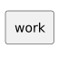

<!-- api-agent-companion-v1 sha256:083aa9ccf76944e65ef453dba229a04878fafc990576330d63b7da8836f3712c -->
# Workflow diagram: work

[Open standalone diagram](work.svg)

[Source declaration](../../work.md.html)

## Navigation

- [artifact_qualification](flow.md)
- [intake](intake.md)
- [review](review.md)
- [finish](finish.md)
