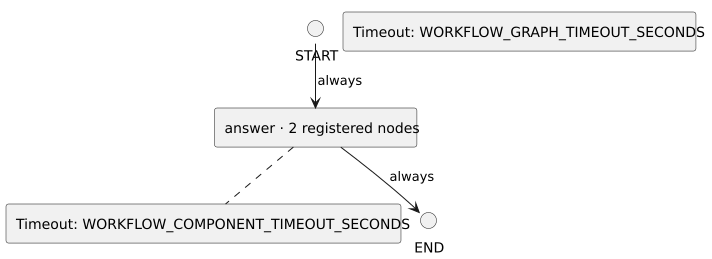

<!-- api-agent-companion-v1 sha256:21f1b1a4c0c80d4d6789c5d823dbc4ea63df681a4ecbab159a732ced5c36cd47 -->
# Workflow diagram: workflow_preferences

[Open standalone diagram](flow.svg)

[Source declaration](../../flow.md.html)

## Navigation

- [answer](workflows/components/answer.md)
- [draft](workflows/components/answer/draft.md)
- [review](workflows/components/answer/review.md)
