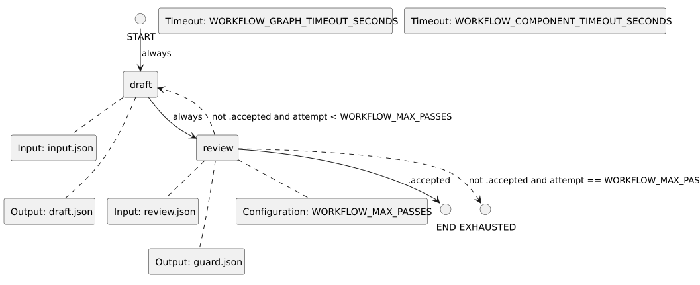

<!-- api-agent-companion-v1 sha256:ee5623127f34d520ff09b2a59bb5fc213b5d667988ddb8bf3f2f70bc2e52afe9 -->
# Workflow diagram: answer

[Open standalone diagram](answer.svg)

[Source declaration](../../../../workflows/components/answer.md.html)

## Navigation

- [workflow_preferences](../../flow.md)
- [draft](answer/draft.md)
- [review](answer/review.md)
