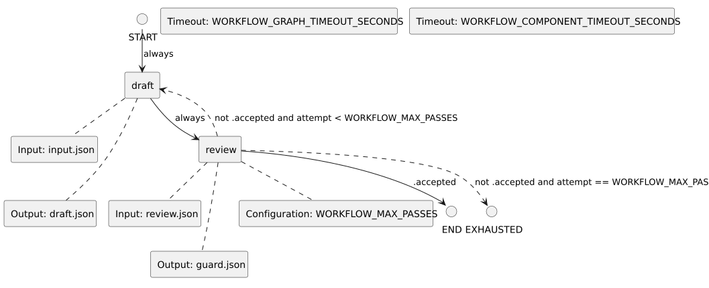

<!-- api-agent-companion-v1 sha256:a453998f0ecb1967b65cf8e9063570b670750513ebbbd03459cdfeb12514c834 -->
# Workflow diagram: answer

[Open standalone diagram](answer.svg)

[Source declaration](../../../../workflows/components/answer.md.html)
