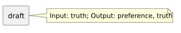

<!-- api-agent-companion-v1 sha256:a42ea20ca3e20781f76c959b9a5522acc37d6a58d1655de1ce094b9f46278715 -->
# Workflow diagram: draft

[Open standalone diagram](draft.svg)

[Source declaration](../../../../../workflows/components/answer/draft.md.html)

## Navigation

- [workflow_preferences](../../../flow.md)
- [answer](../answer.md)
- [review](review.md)
