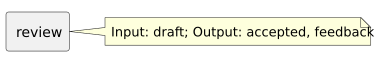

<!-- api-agent-companion-v1 sha256:1477b6e46d811cc1ac589a212ffdb6ab74bafd9503f19fe7b69f989f4366e900 -->
# Workflow diagram: review

[Open standalone diagram](review.svg)

[Source declaration](../../../../../workflows/components/answer/review.md.html)

## Navigation

- [workflow_preferences](../../../flow.md)
- [answer](../answer.md)
- [draft](draft.md)
